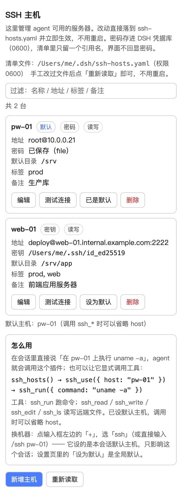

# dsh-ssh-hosts

[](https://github.com/alfredhuang211/dsh-ssh-hosts/actions/workflows/test.yml)
[](LICENSE)

给 DeepSeek Harness（dsh）加一组 SSH 工具：**把若干台服务器存成一份主机清单，agent 在会话里用主机名引用它们** —— 执行命令、读文件、写文件、改文件、列目录。

- 凭据只存**怎么连**（host / user / identityFile / 跳板），不存密码、不存密钥内容；
- 认证、known_hosts、ssh-agent 全部交给系统 OpenSSH，插件不重新实现加密；
- 多机：同时配置 N 台，一次调用指定一台；会话里可以 `ssh_use` 设默认机；
- **图形界面管理**：在 `设置 → 插件 → dsh-ssh-hosts`（或设置侧栏「SSH 主机」）里新增/编辑/删除主机、测连通性、设默认机；界面写的就是那份 YAML，改完立即生效，不用重启；
- 与本地同名工具语义一致（`read` 的 offset/limit 是行号，`edit` 要求 oldString 唯一）。

## 装

### 方式零：直接从 GitHub

```bash
git clone https://github.com/alfredhuang211/dsh-ssh-hosts.git
dsh plugin --profile web add ./dsh-ssh-hosts      # 桌面版则在「设置 → 插件」里选这个目录
```

[Releases](https://github.com/alfredhuang211/dsh-ssh-hosts/releases) 里也有打包好的 `dsh-ssh-hosts-x.y.z.tgz`，适合离线安装或内网分发。

### 方式一：桌面 App / CLI 的插件安装（推荐）

```bash
# CLI：把本目录（或 npm pack 出的 tgz）装进某个 profile
dsh plugin --profile web add /绝对路径/plugin-dev/ssh-hosts
```

装完 `dsh web --dump-config | grep -A2 ssh-hosts` 应该能看到：

```
# == dsh-ssh-hosts
- id: ssh-hosts
  name: dsh-ssh-hosts
```

桌面版也可以在 **设置 → 插件** 里安装同一个 tgz / 目录；本插件声明了 `dsh.bundle.patch`，安装后会自动作为一层 bundle 参与 profile 组装（`insert` 一行 `id: ssh-hosts`）。

> 桌面 App 自己的 `desktop` profile 由 Electron 独占：`dsh plugin --profile desktop ...` 会被拒绝（`profile "desktop" is managed exclusively by the Electron application`）。要装进桌面 App，请从 App 内的插件界面装，或者按 App 写 package.json 的方式加 `link:`/依赖后由 App 重启加载 —— 别去手改它的 profile 状态。

### 方式二：手写 patch 行

不想用它自带的 bundle patch、或想在别人的 profile 里手动挂，就在 `~/.dsh/profiles/<name>/cordis.patch.yml`（或 `~/.dsh/cordis.patch.yml`）里加：

```yaml
- insert:
  - id: 'ssh-hosts'
    name: 'dsh-ssh-hosts'      # 也可以写 file:///绝对路径/plugin-dev/ssh-hosts/lib/index.js
    config:
      defaultHost: web-01
```

`config` 全部字段都有默认值，只写需要覆盖的即可。

## 配置

主机清单有两条路，用的是**同一份数据**（`ssh-hosts.yaml`）：

- **图形界面（推荐）**：装好后打开 `设置 → 插件 → dsh-ssh-hosts`（或设置侧栏的「SSH 主机」），在那里新增/编辑/删除主机、测试连通性、设默认机。界面写的就是下面这个 YAML，写完立即重载，**不用重启**。
- **手工编辑**：直接改 YAML；改完在界面上点「重新读取」，或重启。



*窄列下的样子：一台主机一个块，事实在上、操作在下，长路径自己断行。*

界面能做的事：

| 能力 | 说明 |
| --- | --- |
| 新增 / 编辑 / 删除 / 设默认 | 字段校验与服务端同一套规则：错了当场红框标出**并说明怎么改**，不用等一次 400 |
| 测试连接 | 结果就地显示在那台主机下面（成功给耗时与远端首行，失败给 exit code 与原因），不用去翻底部日志 |
| 删除二次确认 | 在块内确认，并说清会连带清掉什么（例如「已存密码也一并清除」），不可撤销 |
| 过滤 | 主机多了按名称 / 地址 / 标签 / 备注 / 认证方式过滤，并显示匹配台数 |
| 键盘 | `Enter` 保存、`Esc` 取消；错误是 `role="alert"`、日志是 `aria-live`，读屏能听到 |
| 密码 | 只写不读：显示「已保存（来自哪一层）」或「未设置」，输入可显示/隐藏，清除要再确认一次 |
| 空状态 | 没有主机时直接给「新增主机」按钮 + 手工编辑提示，不用猜下一步做什么 |

### 1. 主机清单（界面与手工共用的那份文件）

```bash
cp ssh-hosts.example.yaml ~/.dsh/ssh-hosts.yaml
chmod 600 ~/.dsh/ssh-hosts.yaml     # 权限不是 0600 会被拒绝加载
$EDITOR ~/.dsh/ssh-hosts.yaml
```

文件**不存在**时插件照常启动、界面照常打开，只是清单为空：在界面上新增第一台主机就会把文件建出来（0600）。文件存在但坏掉（YAML 语法错、`hosts` 不是数组、权限过宽）仍然是**装载期硬失败** —— 那是真配置错误，越早炸越好。

```yaml
version: 1

hosts:
  - name: web-01                    # ← agent 在会话里引用的名字
    host: 10.0.0.11
    user: deploy
    identityFile: ~/.ssh/id_ed25519 # 密钥登录；必须 0600。省略 = 交给 ssh-agent/默认密钥
    defaultWorkdir: /srv/app
    description: 生产 Web（Nginx）
    tags: [prod, web]
    port: 22
    proxyJump: bastion              # 本清单里的 name，或 user@host:port
    connectTimeoutSec: 15
    keepAliveSec: 30
    readOnly: true                  # 拒绝 ssh_write / ssh_edit

  - name: db-01
    host: 10.0.0.12
    user: root
    passwordRef: DSH_SSH_HOSTS_PASSWORD_DB_01   # 密码登录：只写「凭据名」，不写密码
    tags: [prod, db]
```

字段全部可选（`name` / `host` 必填），**未知字段会直接报错**，拼错不会被静默忽略。清单里写 `password:` / `passphrase:` 会被专门拒绝，并告诉你该怎么放密码。

### 1.1 登录方式：密钥 / 密码 / ssh-agent

| 方式 | 清单里怎么写 | 怎么设置 |
| --- | --- | --- |
| **密钥**（推荐） | `identityFile: ~/.ssh/id_ed25519` | 界面「登录方式 → 密钥文件」，填路径即可（文件必须存在且 0600） |
| **密码** | `passwordRef: DSH_SSH_HOSTS_PASSWORD_XXX` | 界面「登录方式 → 密码」，在密码框里填一次；插件把值交给 DSH 凭据库，清单里只留引用名 |
| **密钥优先、密码兜底** | 两个字段都给 | 界面选「密钥优先，密码兜底」 |
| **ssh-agent / 默认密钥** | 两个字段都不给 | 界面选「ssh-agent / 默认密钥」，交给 OpenSSH 自己挑 |

密码**不进清单文件**：`$DSH_HOME/.credentials.yaml`（0600，DSH 自己的凭据库）存值，`ssh-hosts.yaml` 只存名字。所以清单可以安全地备份/分享；界面、HTTP 响应、模型可见的工具输出里都**只回报「有没有、来自哪一层」**，永远不回显密码。删主机或点「清除已存密码」会顺手把凭据库里的那条删掉，不留孤儿。

密码登录的实现是 OpenSSH 官方路子（`SSH_ASKPASS` + 一次性 0600 文件）：密码不进命令行参数、不进环境变量、不进日志，`ps` 里看不到；每次调用前现解析、用完即删，所以改完密码**下一次调用就生效**，不用重启。没有凭据服务的 profile（极少见）插件照常工作，只是密码主机连不上，界面会说明原因。

### 2. 图形界面背后的 HTTP 路由

界面（浏览器半边）通过同源路由读写清单，也**可以只用 curl**（同一个 web server，CSRF/Host 校验与其它 GUI 接口一致）：

| 方法 | 路径 | 作用 |
| --- | --- | --- |
| GET | `/ssh-hosts/hosts` | 清单 + 文件信息 + 是否可写 + 默认机 |
| POST | `/ssh-hosts/hosts` | 新增/修改一台（`{ host: {...}, previousName?, password?, clearPassword? }`，改名靠 `previousName`；`password` 只进不出，`clearPassword: true` 清除） |
| POST | `/ssh-hosts/hosts/delete` | 删除（`{ name }`） |
| POST | `/ssh-hosts/default` | 设/清默认机（`{ name }`，空串清除） |
| POST | `/ssh-hosts/reload` | 重新读盘（手工改完文件点这个） |
| POST | `/ssh-hosts/test` | 真实 SSH 连上去跑一条只读命令 |

返回统一是 `{ ok: true, value }` 或 `{ ok: false, error: { code, message } }`；`400` 参数/文件内容有误、`409` 清单来自 config 不可写、`404` 主机不存在、`501` 当前 profile 没有凭据服务（存不了密码）、`403/401` 未过 Host/来源/登录校验。写入顺序是**先校验、再原子写、再重载**，重载失败会把文件回滚成写之前的字节 —— 界面上一次误操作不会让正在跑的会话失去目标机。

### 3. 插件 config

| 字段 | 默认 | 说明 |
| --- | --- | --- |
| `hostsFile` | `$DSH_HOME/ssh-hosts.yaml` | 清单路径；相对路径按 `$DSH_HOME` 解析 |
| `defaultHost` | 空 | 没指定 host、本会话也没 `ssh_use` 过时用的默认机 |
| `knownHostsFile` | 空（OpenSSH 默认） | 自定义 known_hosts 路径 |
| `strictHostKeyChecking` | `accept-new` | `accept-new` / `yes` / `no` |
| `connectTimeoutSec` | 10 | 建连超时 |
| `timeoutMs` | 60000 | 单条命令默认超时 |
| `maxOutputBytes` | 262144 | stdout/stderr 各自保留上限（超出保尾并标记截断） |
| `maxReadBytes` | 8388608 | 单文件读取上限 |
| `controlPersistSec` | 300 | 连接复用时长；0 = 每次重建连 |
| `allow` / `deny` | `[]` | `ssh_run` 命令正则白/黑名单（deny 优先） |
| `hosts` | `[]` | 就地声明主机（非空时忽略 `hostsFile`） |

这些标量字段都是 DSH 的 **volatile** 字段：在设置页改完**不用重启插件**，下一次工具调用就用新值（插件每次读配置都解包 volatile 引用）。`hosts` 例外 —— 它是部署方声明，改了要重启；而且它非空时界面变成只读，避免「设置页改一半、YAML 改一半」。

## 用：添加完主机，怎么引用

**在会话窗口里直接选**（新增，最快）：点输入框左边的 **「+」**，在命令菜单里选 **`ssh`** → 弹出主机列表（带 `user@host`、标签、认证方式，并标出本会话当前在用哪台）→ 点一台即可。它设的是**本会话**默认主机（和 `ssh_use` 同一条路径、同一份状态），之后你在这个会话里说「执行 uname -a」就直接落到那台机器。也可以手打 `/ssh <主机名>`，`/ssh clear` 清除。

> 一个平台规则：输入框里**已经有内容**时，「+」菜单只列不带参数的命令（`ssh` 带参数提示，所以那时不显示）—— 这是 DSH 对斜杠菜单的统一约定，`/permission` 等命令同样如此。想在已有草稿上换机器，先选中草稿前的空白再点「+」，或直接手打 `/ssh <主机名>`。

**在会话里直接说人话也行**（最常用）：

```
在 web-01 上执行 systemctl status nginx
看一下 db-01 的 /etc/mysql/my.cnf
把 web-01 的 /srv/app/.env 里 PORT=8080 改成 PORT=9090
```

agent 会先 `ssh_hosts()` 看清单，再带上 `host: "web-01"` 调用对应工具。主机名就是你在界面里填的「名称」。

**显式调用**（想知道底层发生了什么时）：

```
ssh_hosts()                                        → 列主机（含 auth 方式、tags、默认目录）
ssh_use({ host: "web-01" })                        → 设为本会话默认机，之后可以省略 host
ssh_run({ command: "uname -a" })                   → 在默认机上跑
ssh_run({ host: "db-01", command: "df -h" })       → 指定机器跑（不依赖默认机）
ssh_read({ host: "web-01", path: "/etc/nginx/nginx.conf", offset: 1, limit: 40 })
ssh_write({ host: "web-01", path: "/tmp/hello.txt", content: "hi\n" })
ssh_edit({ host: "web-01", path: "/srv/app/.env", oldString: "PORT=8080", newString: "PORT=9090" })
ssh_ls({ host: "web-01", path: "/srv/app" })
```

主机解析优先级：**显式 `host` 参数 → 本会话 `ssh_use` → 界面设的默认机 → `config.defaultHost` → 报错并列出可用主机**（绝不再猜一台）。界面上点「设为默认」写的就是第三档；默认机是**全局**的，`ssh_use` 是**本会话**的。

模型看到的 7 个工具：

| 工具 | 作用 |
| --- | --- |
| `ssh_hosts` | 列出可用主机（含 tags / 说明 / 默认目录 / 认证方式），可按 tag 过滤；`defaultHost` + `defaultSource` 告诉你本次调用实际会用哪台 |
| `ssh_use` | 读/设本会话默认主机，之后其它工具可省略 `host` |
| `ssh_run` | 执行命令，返回 exitCode / stdout / stderr（**非零退出是正常结果**） |
| `ssh_read` | 读文本文件，可给行号区间 |
| `ssh_write` | 整文件写入（远端临时文件 + rename 原子替换，保留原权限） |
| `ssh_edit` | 精确字符串替换（要求唯一匹配，除非 `replaceAll`） |
| `ssh_ls` | 列目录（类型/权限/大小/时间） |

主机解析优先级：**显式 `host` 参数 → 本会话 `ssh_use` → 界面设的默认机 → `config.defaultHost` → 报错并列出可用主机**（绝不再猜一台）。

三种方式的作用域要分清：**会话窗口的「+ → ssh」和 `ssh_use` 是「本会话」**（互不干扰，换会话就没了）；**设置页的「设为默认」是全局**（所有没有会话默认的会话都用它）。`ssh_hosts` 报的 `defaultHost` 是**本次调用实际会用的那台**（会话默认 → 全局默认 → `config.defaultHost`），`defaultSource` 告诉你是哪一档。

`readOnly: true` 的主机会拒绝 `ssh_write` / `ssh_edit`（`ssh_run` 不受限，见下面「安全边界」）。命令的 `allow` / `deny` 白黑名单由部署方在插件 config 里配，命中 deny 时工具直接拒绝并说明原因。

界面上每张主机卡片下面还有一段「怎么用」，会带着这台机器的名字把上面的引用方式印出来，不用记。

## 安全边界（重要）

- **秘密与配置分家**：`ssh-hosts.yaml` 里只有路径和**凭据名**，永远没有密码或密钥内容。密码值存在 DSH 凭据库 `$DSH_HOME/.credentials.yaml`（0600），只有插件按名字去 `ctx.credentials` 解析；界面/HTTP/工具输出里从不回显值。密钥的 passphrase 仍由 ssh-agent / 系统钥匙串负责。
- **密码只走 OpenSSH 官方通道**：`SSH_ASKPASS` 指向插件临时生成的助手脚本，密码放在同一 0700 临时目录里的 0600 文件，**不进 argv、不进 env、不进日志**，调用结束（含异常）立刻整目录删除；`NumberOfPasswordPrompts=1` 保证密码错了只试一次，不会撞锁。模型侧**没有任何**能设置或读取密码的工具 —— 只有你在界面里能填。
- **权限即护栏**：清单文件 0600、`identityFile` 必须 0600，否则拒绝加载 —— 这两条是刻意做成硬失败的（界面写文件时自动 0600、目录 0700）。
- **界面就是本机操作员**：`/ssh-hosts/*` 路由先过 `connection.requestRejection`（Host/来源校验 + 浏览器登录态），过不了直接 403/401；与其它 GUI 接口同一道门。它只在本机 loopback web server 上暴露。
- **`readOnly` 只是给模型的护栏，不是沙箱**：它只拦 `ssh_write` / `ssh_edit`；`ssh_run` 里照样能 `tee`。真正的边界是远端账号权限 + DSH 的审批/日志。
- **`allow` / `deny` 是部署方的运维约定**，同样不是安全边界（正则拦命令永远可以绕过）。
- **断连即失败，不重连不重放**：远端是否已执行无法确认，自动重试可能让命令生效两次。
- **输出有上限**：`ssh_run` 超限保尾部并标记 `truncated`；`ssh_read` 超限直接拒绝（不把大文件拉回本地）。
- 每条命令都经过 DSH 的审批与日志链路，与本地 Bash 工具同级别。
- **`/ssh` 命令只改「本会话用哪台机器」，不碰清单、不碰凭据**：它和 `ssh_use` 工具写的是同一份会话状态（`ssh-hosts.state.json`），并且会留下一条持久化的命令节点（`command/run` + `command/done`），可审计、可回溯。

## 测试

```bash
npm install
npm test                      # 211 个单测：配置 / 清单 / 会话状态 / 传输层（含密码 askpass）/ 业务逻辑 / 工具契约 / /ssh 命令 / cordis 装载 / 界面链路 / 浏览器半边
```

真实服务器集成测试（默认跳过）：

```bash
DSH_SSH_HOSTS_REMOTE=1 node --test test/remote.test.mjs
# 密码认证那一条要显式给密码（只从环境变量读，不落盘、不进仓库）：
DSH_SSH_HOSTS_REMOTE=1 DSH_SSH_HOSTS_REMOTE_PASSWORD='...' node --test test/remote.test.mjs
node scripts/smoke-remote.mjs            # 把模型会看到的每一步原样打出来
node scripts/smoke-ui.mjs                # 界面链路：路由新增主机 → 真连测试 → 工具立刻能用 → 删除
DSH_SSH_HOSTS_REMOTE_PASSWORD='...' node scripts/smoke-ui.mjs   # 额外跑一遍「界面填密码 → askpass → 真 ssh」
```

`smoke-ui.mjs` 走的是「在设置里点一下」的完整路径（HTTP 路由 → service → 写 YAML → 重载 → 工具发起真实 SSH），清单文件用临时目录里的一份，不碰 `~/.dsh/ssh-hosts.yaml`。

覆盖目标机可用环境变量覆盖：`DSH_SSH_HOSTS_REMOTE_HOST / _USER / _PORT / _KEY / _KNOWN_HOSTS`。

### 测试机准备

只做一次，全程只用密钥：

```bash
ssh-keygen -t ed25519 -N '' -f .test-keys/id_ed25519      # 已在仓库里生成过
ssh-copy-id -i .test-keys/id_ed25519.pub ubuntu@your-host # 或手工追加到远端 authorized_keys
ssh -i .test-keys/id_ed25519 -o IdentitiesOnly=yes ubuntu@your-host 'echo KEY_OK'
```

`~/.ssh` 不可写、或需要非交互装公钥时（CI / 沙箱里 pty 被禁），用 `SSH_ASKPASS` 而不是 `sshpass`：

```bash
SSH_ASKPASS=$PWD/.test-keys/askpass.sh SSH_ASKPASS_REQUIRE=force \
  ssh -o PreferredAuthentications=password -o PubkeyAuthentication=no ubuntu@your-host \
  'mkdir -p ~/.ssh; touch ~/.ssh/authorized_keys; cat >> ~/.ssh/authorized_keys; chmod 700 ~/.ssh; chmod 600 ~/.ssh/authorized_keys' \
  < .test-keys/id_ed25519.pub
```

## 故障排查

| 现象 | 处理 |
| --- | --- |
| `主机清单不存在` | 复制示例文件并 `chmod 600`，或用 config 里的 `hosts: [...]` |
| `主机清单权限过于宽松` / `identityFile 权限过于宽松` | 按提示 `chmod 600` |
| `认证失败（auth）` | 检查 `user` / `identityFile`，或 `ssh-add` 载入密钥；密码主机看下一条 |
| `配置为密码登录，但凭据 … 还没有值` | 在设置界面「SSH 主机」里给这台机器填一次密码（模型侧故意不能设密码） |
| 界面提示「当前 profile 没有 credentials 服务」 | 该 profile 没装凭据库：改用密钥/ssh-agent，或在桌面应用里配置 |
| 「+」菜单里找不到 `ssh` | 该 profile 的 commands 服务缺失（裁剪过的组合），或命令名被别的插件占了；手打 `/ssh <主机名>` 同样可用，工具本身不受影响 |
| `主机指纹校验失败（hostkey）` | 目标机重装过：清理对应 known_hosts 条目（或用 `knownHostsFile` 单独放一份） |
| `超时（timeout）` | 调大 `connectTimeoutSec`（建连）或调用参数 `timeoutMs`（命令） |
| 命令 `exit 66` | 远端 `cwd` 不存在（插件用 `cd ... \|\| exit 66` 区分「进不去目录」和「命令失败」） |

## 已知边界

- 传输用系统 `ssh`/`sftp` 客户端，因此**没有 Windows 支持**（Windows 上没有这两个命令行程序）。
- 带 passphrase 的密钥依赖 ssh-agent 预先载入；插件不做交互式输入。
- 文件工具限于 UTF-8 文本；二进制/大文件请用 `ssh_run` + 远端工具处理。
- 不做端口转发 / 隧道 / 交互式 shell 会话（每次调用一条命令，靠 ControlMaster 摊掉握手成本）。
- 界面卡片按**窄列**设计（设置侧栏那种宽度）：主机是纵向堆叠的块，字段自动换行，不会出现横向滚动。
- 官方另有一套 provider 形态的 `@deepseek-ai/dsh-ssh` / `dsh-fs-ssh` / `dsh-subprocess-ssh` / `dsh-sandbox-ssh`：它们把 `ctx.fs` / `ctx.subprocess` 整体换到单台远端机，属于「部署组合」而非多机工具。本插件与它们不冲突，也不依赖它们。

## 许可证

MIT（见 [LICENSE](LICENSE)）。测试机相关的主机名/用户/密钥路径在仓库里都是占位值，通过 `DSH_SSH_HOSTS_REMOTE_*` 环境变量传入；真实凭据从不入库。
